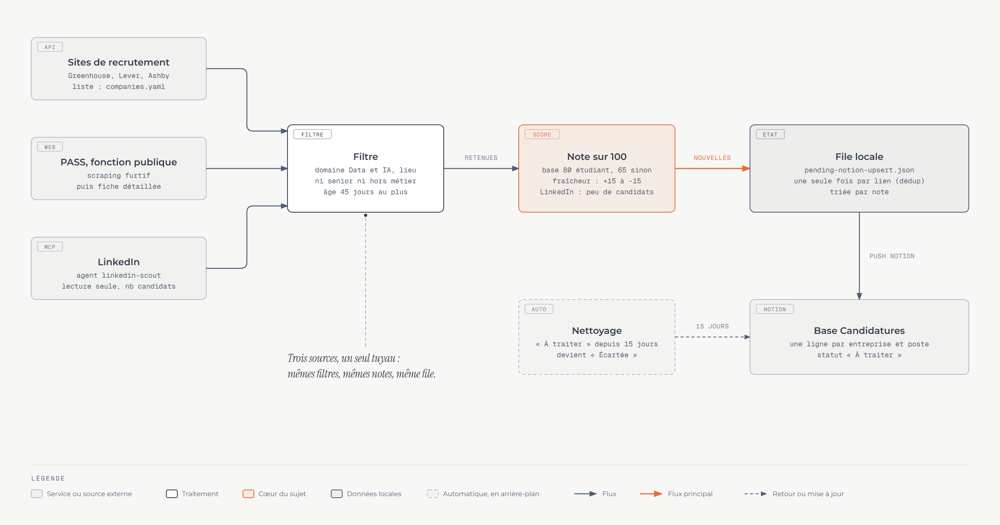

# Excalidraw dans le Job-Hunt Kit

Statut : à jour et vérifié le 2026-10-19 (voir la section 8) · Auteur : projet Job-Hunt Kit · Liens : [architecture](../../architecture.md), [connexions](../../connexions.md), [logos](logos/README.md)

Ce document explique comment le projet fabrique ses schémas Excalidraw (avec le serveur MCP ou par script Python), comment les convertir en PNG, PDF ou lien, et recense les formes et les structures déjà employées.

## 1. Trois façons de produire un schéma

| Voie | Qui dessine | Sortie | Quand l'utiliser |
| --- | --- | --- | --- |
| A. Serveur MCP `excalidraw-studio` | Claude, par appels d'outils, en direct | un « checkpoint » visible dans l'écran local | explorer une idée, retoucher à la main ensuite |
| B. Kit Python du dépôt (`kit.py`) | un script décrit blocs et flèches | PNG dans `docs/diagrams/` et `.excalidraw` | schémas stables, versionnés, reproductibles |
| C. Générateurs de cartes longues (dossiers locaux de `outputs/`, jamais versionnés) | un script par carte | `.excalidraw`, PNG, PDF d'une page | cartes verticales détaillées, jointes à une candidature |

Le format pivot est le fichier **`.excalidraw`** (du JSON) : on l'ouvre sur excalidraw.com ou dans l'extension VS Code pour retoucher à la main, puis on l'exporte (PNG, PDF, lien : section 3).

## 2. Le serveur MCP `excalidraw-studio`

### 2.1 Ce que c'est

Une copie locale du dépôt CopilotKit du même nom (licence MIT) : un serveur MCP (dossier `server/`) qui dessine des diagrammes Excalidraw, et un écran Next.js (racine) pour les parcourir et les retoucher. Les commandes ci-dessous supposent `STUDIO` = racine de ce dépôt. La copie contient une modification locale : la limite de taille d'un checkpoint passe de 5 Mo à 100 Mo (`server/src/checkpoint-store.ts`).

### 2.2 Démarrer le serveur

```bash
# usage courant : écran (port 3002) et serveur MCP (port 3001), version construite
cd "$STUDIO" && npm run prod                # lance : next start -p 3002 et node server/dist/index.js

# développement : serveur MCP seul (bun --watch), ou écran et serveur qui se recompilent
cd "$STUDIO/server" && npm run serve        # ou, à la racine : npm run dev
```

`npm run prod` suppose les deux builds faits (`npm run build:all`, une seule fois). Le mode développement demande Node et bun (`npm install` dans `server/` appelle `scripts/setup-bun.mjs`). Le chat de l'écran, lui, demande une clé de modèle dans le `.env.local` du dépôt ; le serveur MCP seul n'en demande aucune.

### 2.3 Le déclarer à Claude Code

```bash
claude mcp add --transport http excalidraw-studio http://localhost:3001/mcp
claude mcp list        # ✔ Connected si le serveur tourne, sinon ✘ ECONNREFUSED
```

Le serveur est déjà déclaré pour ce projet (portée locale, dans `~/.claude.json`) ; le modèle versionné est `.mcp.example.json` à la racine du kit. Lancez le serveur **avant** d'ouvrir la session, sinon relancez la session pour récupérer les outils. Sur un autre port : `PORT=3005` devant la commande du serveur (variable lue par `main.ts`), puis changez l'adresse. Le connecteur Excalidraw de claude.ai, quand il est disponible sur le compte, remplace tout cela sans serveur local.

### 2.4 Les outils exposés

Liste lue sur le serveur en marche (`tools/list`) :

| Outil | Vu par Claude | Rôle |
| --- | --- | --- |
| `read_me` | oui | renvoie la fiche de format (éléments, palettes, caméra, exemples) ; un seul appel par conversation, avant de dessiner |
| `create_view` | oui | dessine un tableau complet d'éléments (`elements` = chaîne JSON, `title`, `folder`, `checkpointId` pour écraser) ; sert aux retouches |
| `draw_element` | oui | ajoute 1 à 6 éléments par appel, avec le même `sessionId` : le dessin se construit sous les yeux ; sauvegarde au dernier appel |
| `export_to_excalidraw` | non (écran) | envoie le dessin chiffré à excalidraw.com et renvoie un lien `#json=...` |
| `fetch_image` | non (écran) | lit une image (URL ou chemin local) et la renvoie en data URI : sert aux logos |
| `save_checkpoint`, `read_checkpoint` | non (écran) | l'écran lit et sauvegarde les retouches faites à la main |

### 2.5 Dessiner avec Claude : la méthode

1. Appeler `read_me` une fois.
2. Nouveau schéma : `draw_element`, section par section (une zone et ses blocs, puis leurs flèches). Retouche : `create_view`.
3. Premier élément : `cameraUpdate` au format 4:3 (400x300, 600x450, 800x600, 1200x900 ou 1600x1200), émis **avant** ce qu'il cadre. Garder une marge.
4. Ordre d'émission : fond, forme, son texte, ses flèches, forme suivante. L'ordre du tableau est l'ordre d'empilement.
5. Texte de 16 au moins (titres 20), jamais de gris clair sur blanc (minimum `#757575`), pas d'émoji (la police les perd), identifiants uniques.
6. Reprendre un dessin : premier élément `{"type":"restoreCheckpoint","id":"<id>"}`, puis les nouveaux éléments ; `{"type":"delete","ids":"a1,b2"}` retire des éléments (ne jamais réutiliser un identifiant supprimé) ; avec `checkpointId`, le dessin est écrasé sur place.

Exemple minimal (tiré de la fiche `read_me`, non exécuté ici) :

```json
[
  {"type":"cameraUpdate","width":800,"height":600,"x":0,"y":0},
  {"type":"rectangle","id":"a","x":100,"y":100,"width":220,"height":90,"roundness":{"type":3},"backgroundColor":"#a5d8ff","fillStyle":"solid","label":{"text":"Radar","fontSize":20}},
  {"type":"rectangle","id":"b","x":450,"y":100,"width":220,"height":90,"roundness":{"type":3},"backgroundColor":"#b2f2bb","fillStyle":"solid","label":{"text":"Notion","fontSize":20}},
  {"type":"arrow","id":"f","x":320,"y":145,"width":130,"height":0,"points":[[0,0],[130,0]],"endArrowhead":"arrow","label":{"text":"offres"}}
]
```

Couleurs de la fiche : fonds pastel `#a5d8ff` (bleu), `#b2f2bb` (vert), `#ffd8a8` (orange), `#d0bfff` (violet), `#ffc9c9` (rouge), `#fff3bf` (jaune), `#c3fae8` (turquoise) ; zones `#dbe4ff`, `#e5dbff`, `#d3f9d8` à 30 % d'opacité ; fond sombre `#1e1e2e`.

### 2.6 Où vont les dessins

- Chaque dessin est un fichier `~/.excalidraw-local/checkpoints/<id>.json` (identifiant de 18 caractères ; champs `elements`, `title`, `folder`, `_mtime`).
- L'écran, sur `http://localhost:3002` : `/workspaces` liste les dessins enregistrés, `/workspace/<id>` ouvre l'éditeur complet, « Edit with AI » recharge le dessin dans le chat.
- API HTTP du serveur (port 3001), utilisée par l'écran et par les scripts de publication :

| Requête | Effet |
| --- | --- |
| `POST /checkpoint` | crée un dessin (`elements`, `title`, `folder`), renvoie son `id` |
| `GET /checkpoints` | liste `id`, `title`, `folder`, date |
| `GET`, `PUT`, `PATCH`, `DELETE /checkpoint/:id` | lire, remplacer, modifier, supprimer (`?hard=true` pour une suppression définitive) |
| `ALL /mcp` | point d'entrée MCP (HTTP en flux) ; `node dist/index.js --stdio` existe pour un client stdio |

> **Limite de dessins : 1 000 par défaut depuis le 2026-10-22** (100 dans le dépôt d'origine, qui n'a pas changé depuis le 2026-04-01). À chaque sauvegarde, le serveur supprime les plus anciens au-delà de la limite (`MAX_FILE_CHECKPOINTS`, dans `server/src/checkpoint-store.ts`). On la règle avec la variable d'environnement `EXCALIDRAW_MAX_CHECKPOINTS` avant `npm run prod` ; après toute modification du fichier : `cd server && npm run build`, puis relancer `npm run prod`. Le dossier contenait 100 dessins le 2026-10-19, pour 11 Mo. Les fichiers `.excalidraw` sources sur disque restent la vraie sauvegarde, jamais l'écran.

## 3. Convertir en PNG, PDF, image, lien

| Format | Comment | Statut |
| --- | --- | --- |
| `.excalidraw` | écrit par tous les scripts ; s'ouvre sur excalidraw.com | vérifié |
| PNG | `render_long.py` (3.1) ou `build.py` (4) | vérifié |
| PDF d'une page | PNG puis Pillow (3.2) | vérifié |
| PDF A4 en plusieurs pages | `cartes_en_pdf.py` (3.3) | lu, non relancé |
| SVG, JPEG, presse-papiers | barre d'outils du chat de l'écran (d'après le README d'excalidraw-studio) | non essayé |
| Lien excalidraw.com | outil `export_to_excalidraw` (3.3) | lu, non essayé |

### 3.1 Un `.excalidraw` vers un PNG

Le moteur de rendu est Excalidraw lui-même (`exportToSvg`, version 0.18.0) dans un Chrome sans fenêtre pilotée par Playwright. La page de rendu charge la bibliothèque depuis esm.sh : **Internet est nécessaire**.

```bash
cd "$STUDIO/.claude/skills/excalidraw-diagram-skill/references"
uv run render_long.py /chemin/carte.excalidraw --output /chemin/carte.png -s 2 -w 2900
```

- `-s` : échelle de l'image (2 par défaut). `-w` : largeur maximale de la fenêtre (1920 par défaut) ; la fenêtre suit la largeur du dessin jusqu'à cette valeur.
- Premier usage : `uv sync` puis `uv run playwright install chromium` dans ce dossier.
- Mesure : un schéma de 1222 x 802 px se rend en 20 s. L'avertissement `VIRTUAL_ENV ... will be ignored` d'uv est sans effet.
- Les schémas du dépôt ont leur propre rendu, à l'échelle 2 avec 28 px de marge : `build.py` (section 4).

### 3.2 Un PNG vers un PDF d'une page

C'est la recette des cartes envoyées en pièce jointe : une seule page, aussi haute que la carte.

```python
from PIL import Image

Image.MAX_IMAGE_PIXELS = None            # une longue carte dépasse la limite de sécurité de Pillow
image = Image.open("carte.png").convert("RGB")
largeur = 2100
image = image.resize((largeur, round(image.height * largeur / image.width)), Image.LANCZOS)
image.save("carte.pdf", "PDF", resolution=160, quality=70)
```

Résultat mesuré sur le schéma de test : 1 page de 945 pt de large, 177 Ko, **sans couche de texte** (image seule : le texte n'est ni cherchable ni copiable). Pour un petit schéma, rendre en `-s 2` : en `-s 1`, l'agrandissement à 2100 px rend l'image floue. Sur cette machine le `python` de Git Bash est l'environnement du serveur LinkedIn : lancer ce code avec l'interpréteur système, qui a Pillow et Playwright.

### 3.3 Autres sorties : PDF A4 et lien partageable

**PDF A4 en plusieurs pages.** `outputs/entretiens/projets-cartes/cartes_en_pdf.py` redimensionne un PNG à 2437 px de large, le découpe en pages de 3446 px (A4 à 295 dpi) et écrit les aperçus des trois premières pages en 600 x 850. Relire les pages : une coupe peut tomber au milieu d'un bloc.

**Lien partageable.** `export_to_excalidraw` chiffre le dessin dans le serveur local puis l'envoie à `json.excalidraw.com` ; le lien `https://excalidraw.com/#json=<id>,<clé>` donne accès à qui le possède. C'est une publication chez un tiers : ne l'utiliser que pour un contenu qu'on accepte de rendre public.

### 3.4 Relire le rendu

Un texte qui déborde de sa boîte ne se voit que sur une image. `check_card.py <carte.excalidraw> [hauteur]` (dossier des cartes) écrit le PNG, puis des tranches de 2000 px de large dans `_tranches/<nom>/` : regarder chaque tranche avant de dire qu'une carte est finie. Deux défauts de texte ont été trouvés ainsi (un deux-points en début de ligne, un titre sous une étoile décorative).

## 4. Les schémas du dépôt : `kit.py`

Six schémas décrits en Python, rendus par Excalidraw, publiés dans `docs/diagrams/`.

| Fichier | Rôle |
| --- | --- |
| `kit.py` | `Canvas`, `Node`, rôles (couleurs), logos |
| `diagrams.py` | un schéma par fonction (`pipeline`, `overview`, `radar`, `candidature`, `network`, `interface`) et `build_all()` |
| `render.py`, `render.html`, `build.py` | rendu PNG (échelle 2, marge 28 px) et écriture du `.excalidraw`, traits identiques d'un rendu à l'autre (graine fixée) ; `build.py` est le point d'entrée |
| `logos/` | SVG des outils (Simple Icons, CC0 ; Devicon, MIT) |
| `*.excalidraw` | sources modifiables, générées par `build.py` |

```bash
pip install playwright && python -m playwright install chromium   # une fois
python docs/diagrams/excalidraw/build.py            # les six schémas
python docs/diagrams/excalidraw/build.py radar      # ceux dont le nom contient « radar »
```

`build.py` réécrit les PNG versionnés : relire chaque image avant de commiter.

Écrire un schéma :

```python
c = Canvas("radar", 1280, 830, "Titre", "Sous-titre")
src = c.node(40, 170, 250, "web", "Sites", ["ligne 1", "ligne 2"], ["linkedin"], h=146)   # x, y, largeur, rôle, titre, détails, logos
out = c.node(350, 170, 240, "python", "Filtre", ["ligne 1"], ["python"], h=146)
c.arrow([src.right(), out.left()], "retenues", color="#e8590c")     # blocs alignés : sinon la flèche serait diagonale
c.badge(src.x - 12, src.y - 16, 1)                                  # pastille numérotée
c.zone(40, 140, 600, 400, "Sur votre ordinateur", "#f08c00")        # zone en pointillés
c.legend(790)                                                       # légende des rôles utilisés
```

Garde-fous du kit : une flèche diagonale fait échouer le script (`assert`) ; un texte plus large que son bloc est signalé à la construction (`Canvas.check()`) ; les repères d'un bloc sont `top`, `bottom`, `left`, `right` avec un décalage `dx` ou `dy`.

Pièges déjà rencontrés : `convertToExcalidrawElements` régénère les `id` et, pour un texte centré, prend `x` pour l'abscisse du **centre** ; un SVG sans `width` et `height` s'affiche tronqué (le kit en pose un) ; un SVG de Simple Icons est monochrome, le kit lui donne la couleur de sa marque au rendu.

## 5. Formes et structures déjà utilisées

### 5.1 Éléments Excalidraw

Comptés dans les fichiers du projet le 2026-10-19 :

| Jeu | Fichiers | Éléments | Répartition |
| --- | --- | --- | --- |
| Six schémas du dépôt | 6 | 459 | texte 239, rectangle 119, flèche 47, image 43, ellipse 11 |
| Cartes de projets (local) | 36 | 8 637 | texte 4 263, rectangle 1 978, ligne 986, ellipse 712, flèche 536, image 159, losange 3 |
| Cartes d'offres (local) | 10 | 2 674 | texte 1 136, rectangle 557, ligne 438, ellipse 294, flèche 179, image 70 |

| Forme | Emploi |
| --- | --- |
| Rectangle arrondi (`roundness` type 3) | bloc de contenu, panneau, tuile, bouton de rôle ; plein ou hachuré ; en pointillés pour une zone ou une étape automatique |
| Ellipse | pastille numérotée (noire, chiffre blanc), bulle ronde portant un ou plusieurs logos, tête de bonhomme croquis |
| Losange | décision dans un organigramme (3 occurrences seulement) |
| Flèche | orthogonale pour relier des blocs ; coudée avec étiquette ; courbe pour une annotation manuscrite ; pointillée pour un retour ou une reprise ; double pointe dans 2 cas |
| Ligne | coche, croix, bonhomme croquis, traits d'icône (jamais de pointe) |
| Texte | police 5 (Excalifont, écriture à la main) pour tout le texte courant ; police 3 (Cascadia) pour le code (249 occurrences dans les cartes de projets) |
| Image | logo SVG en data URI, posé dans une pastille blanche aux bords gris `#ced4da` (52 px de côté autour d'un logo de 34 px dans le kit) |

Styles : `roughness` 1 (trait à main levée) dans les schémas du dépôt, mélange de 0 et de 1 dans les cartes ; remplissage `solid` en majorité, `hachure` (remplissage par défaut de `box`) pour de nombreux encadrés, dont le bandeau de conclusion ; `strokeStyle` `dashed` pour les zones et les étapes automatiques.

### 5.2 Couleurs

Rôles du kit des schémas du dépôt (une teinte pastel par rôle, la légende se construit toute seule) :

| Rôle | Remplissage | Trait | Sens |
| --- | --- | --- | --- |
| `web` | `#d0ebff` | `#1971c2` | service en ligne |
| `python` | `#fff3bf` | `#f08c00` | traitement Python |
| `agent` | `#ffe8cc` | `#e8590c` | agent ou modèle IA |
| `data` | `#d3f9d8` | `#2f9e44` | données locales |
| `ui` | `#e5dbff` | `#6741d9` | interface |
| `guard` | `#ffe3e3` | `#e03131` | garde-fou |
| `you` | `#c5f6fa` | `#0c8599` | vous (l'humain) |
| `auto` | `#f1f3f5` | `#868e96` | automatique (pointillés) |

Flux principal : flèches orange `#e8590c`. Cartes longues : teintes nommées (BLUE, GREEN, AMBER, PURPLE, TEAL, ROSE, SLATE, ORANGE, RED, GREY) avec une variante foncée pour le texte ; code en `#22c55e` sur `#1e293b`.

### 5.3 Les six structures de schéma du dépôt

| Schéma | Structure | Ce qu'elle montre |
| --- | --- | --- |
| `pipeline` | chaîne horizontale de trois blocs numérotés, bandeau de conclusion dessous | un parcours en trois temps, avec le geste humain à part |
| `architecture-vue-ensemble` | blocs en étoile autour d'un cœur, trois zones en pointillés (web, ordinateur, services) | ce que le projet relie et où vivent les données |
| `architecture-radar` | entonnoir : trois sources vers un filtre, puis une chaîne, une branche latérale pointillée, une note manuscrite | plusieurs entrées, un seul tuyau |
| `architecture-candidature` | serpentin de huit étapes sur deux rangées, flèche pointillée de retour | un cycle complet avec une seule étape humaine |
| `architecture-reseau` | quatre colonnes de flux, puis une échelle de cinq pastilles colorées | une chaîne de traitement et une graduation (niveaux 1 à 5) |
| `architecture-interface` | pile de couches de gauche à droite, garde-fou en pointillés dessous | qui appelle qui, et ce qui est interdit |



### 5.4 Briques des cartes longues (dossiers locaux)

Les cartes verticales (environ 2 500 px de large, jusqu'à 14 450 px de haut) s'écrivent avec des briques Python : `xd.py` (éléments de base), `d14_bible.py` et `d8_projets_sketch.py` (dossier `schemas/` du premier jeu de cartes d'entretien), `kit_projets.py` et `kit_presentation.py` (dossier `projets-cartes/`), puis un `kit_<offre>.py` par jeu de cartes d'offre.

| Brique | Rend | À utiliser pour |
| --- | --- | --- |
| `chap`, `suite`, `chapter` | chapitre numéroté relié au précédent par une flèche verticale | découper une longue carte |
| `row`, `blocs`, `node`, `bloc` | rangée de blocs de même hauteur reliés par des flèches, avec étiquette, bulle de logo, titre, détails | une chaîne d'étapes |
| `vrow`, `step_box`, `down` | colonne de blocs reliés vers le bas | un enchaînement vertical |
| `lanes` | schéma de séquence : une colonne par acteur, un message par flèche | un échange entre plusieurs acteurs |
| `retry_loop` | flèche en U qui revient à un bloc antérieur | « si ça échoue, on recommence » |
| `branch` | coude étiqueté (oui, non, une cause) | un embranchement |
| `panel`, `two_panels`, `three_panels`, `panels_row`, `side_by_side` | encadrés de puces côte à côte | comparer, énumérer sans tableau |
| `tiles_grid`, `tile3` | grille de tuiles avec étiquette, titre, lignes | un ensemble de faits parallèles |
| `callout`, `callouts_equal`, `chips`, `formula` | encadré court, puces qui passent à la ligne, encadré de formule | une remarque, des mots-clés, un calcul |
| `stat`, `stats_row` | rangée de grosses valeurs | des chiffres mesurés |
| `ruler` | réglette : une bande entre une borne basse et haute, avec seuil | une marge d'erreur |
| `codebox`, `code_columns`, `terminal` | bloc de code sombre ; fenêtre de terminal | du code, une sortie réelle |
| `paper`, `window`, `entity` | feuille au coin plié ; fenêtre d'application ; table de base de données (clé, nom, type) | un document, un écran, un schéma de données |
| `phases` | frise de segments colorés avec texte dessous | un calendrier, des étapes dans le temps |
| `note`, `curved`, `bulle` | annotation manuscrite avec flèche courbe ; bulle de dialogue | désigner la ligne clé, une citation |
| `person`, `check_mark`, `cross_mark`, `bubble_icon`, `tagpill` | bonhomme croquis, coche, croix, bulle ronde, étiquette arrondie | repères visuels |
| `legend`, `entete`, `fin`, `finish_card`, `deja`, `paires` | bandeau de lecture, titre, bandeau final avec signature, bande « déjà fait », paires limite et réponse | ouverture et clôture d'une carte |

### 5.5 Règles de style retenues

- **Pas de tableau dans une carte** : une information en lignes et colonnes devient une grille de tuiles, une chaîne de blocs, deux ou trois panneaux, ou deux flèches avant et après.
- **Vrais logos** dans des pastilles, jamais une pastille de texte quand le logo existe. Le logo officiel se compare au logo posé sur une feuille de contrôle avant publication ; un SVG dont la taille est `1em` reçoit `width` et `height` à 128.
- **Aéré** : jamais de blocs serrés ; une carte peut être grande et dense, pas tassée.
- **Texte** : tout passe par une fonction de découpe (`wrap`) pour ne pas déborder ; un texte reste entre 60 et 2440 px (un texte plus large élargit le rendu) ; espaces insécables avant `:`, `;`, `?`, `!`, dans les guillemets français et entre un nombre et son unité ; le caractère invisible `U+200C` (ZWNJ) empêche Cascadia de fusionner `==`, `!=`, `>=` en un seul signe.
- **Jamais de tiret cadratin** ni de `&` dans un texte généré (le formulaire encode `&amp;`).
- **Une idée par carte**, un bandeau final propre à elle ; une carte présente ce qui fonctionne et ne contient que des faits démontrables.

## 6. Chaîne complète d'une carte (voie C)

1. Écrire ou adapter le générateur (`carte_NN_*.py`) : il écrit `sources/<carte>.excalidraw`.
2. Rendre et relire : `check_card.py` (3.4).
3. Publier dans l'écran local (serveur lancé, port 3001) : `python publier_app.py` ; `--liste` montre ce qui est publié ; les identifiants restent dans `app-ids.json`, donc un nouveau passage met à jour les mêmes cartes sans doublon. Sur une réponse HTTP 413, le script écrit directement le fichier du checkpoint. L'écran trie par date (la plus récente en haut) : le script publie donc de la dernière carte à la première, pour garder l'ordre de lecture. Rester sous 100 dessins publiés (2.6).
4. Exporter en PDF : `exporter(excalidraw, pdf)` du `kit_<offre>.py` appelle `check_card.render` puis la recette 3.2. Regarder chaque tranche du rendu final avant l'envoi.

## 7. Dépannage

| Symptôme | Cause probable | Remède |
| --- | --- | --- |
| `claude mcp list` : `✘ ECONNREFUSED`, ou aucun outil dans la session | serveur arrêté ou lancé après la session | `npm run prod` à la racine de `$STUDIO`, puis relancer la session |
| Rendu qui échoue ou reste bloqué | pas d'Internet (esm.sh) ou Chromium absent | se reconnecter ; `uv run playwright install chromium` |
| `ModuleNotFoundError: PIL` | mauvais interpréteur, ou `python -I` qui ignore les paquets de l'utilisateur | interpréteur système, sans `-I` |
| Des cartes ont disparu de l'écran | plafond de dessins atteint (1 000 par défaut depuis le 2026-10-22, 100 avant) | republier depuis les `.excalidraw` ; garder les sources ; voir `EXCALIDRAW_MAX_CHECKPOINTS` plus haut |
| `PUT` en HTTP 413 | corps trop gros pour l'ancienne limite | écrire le fichier du checkpoint (voir `publier_app.py`) |
| Texte coupé ou chevauché | invisible sans image | `check_card.py` et relire les tranches |
| Flèche refusée par `kit.py` | segment diagonal | passer par un point intermédiaire (coude) |
| PDF flou, ou sans texte à copier | PNG rendu trop petit puis agrandi ; PDF fait d'une image | rendre en `-s 2` ; joindre le texte à part si besoin |

## 8. Ce qui a été vérifié

Vérifié le 2026-10-19 :

- le serveur démarre avec `npm run serve` et répond sur le port 3001 (`GET /checkpoints`, `initialize`, `tools/list` : sept outils, dont quatre réservés à l'écran) ; il a ensuite été arrêté ; `npm run prod` démarre l'écran (3002) et le serveur (3001), qui répondent tous deux ;
- le rendu PNG par `render_long.py` d'une copie d'un schéma du dépôt (20 s) ;
- la conversion de ce PNG en PDF d'une page (945 pt, image seule) ;
- l'exemple `Canvas` de la section 4 (il construit 22 éléments ; avec deux blocs désalignés, `kit.py` refuse la flèche diagonale) ;
- les décomptes de la section 5.1, faits en lisant les fichiers `.excalidraw`.

Lu dans le code, non relancé : `build.py` (il réécrit les images versionnées), `publier_app.py`, `cartes_en_pdf.py`, l'export SVG et JPEG de l'écran, `export_to_excalidraw` (envoi à un service externe). Aucun dessin n'a été créé par `create_view` ou `draw_element` pendant cette vérification, pour ne pas consommer le plafond de 100 dessins. Les noms de fichiers cités dans les dossiers locaux de `outputs/` ne sont pas versionnés : ils n'existent que sur la machine qui les a produits.
